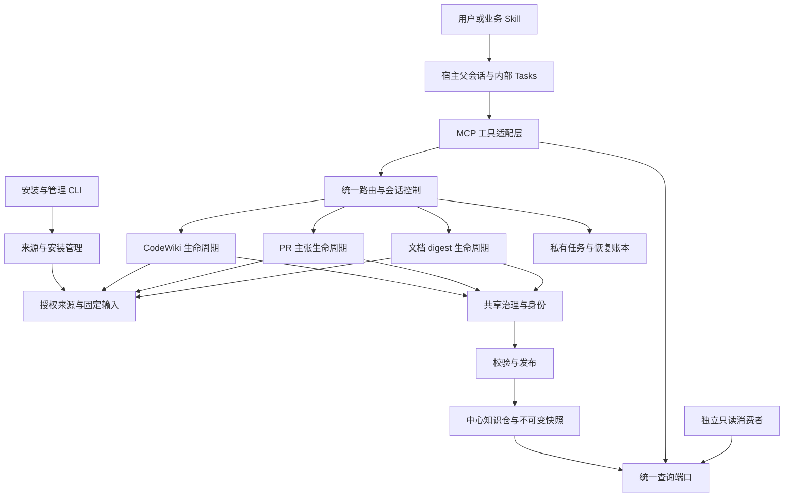
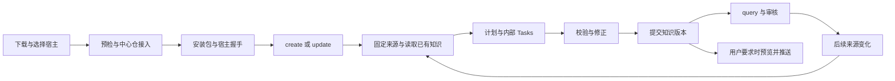
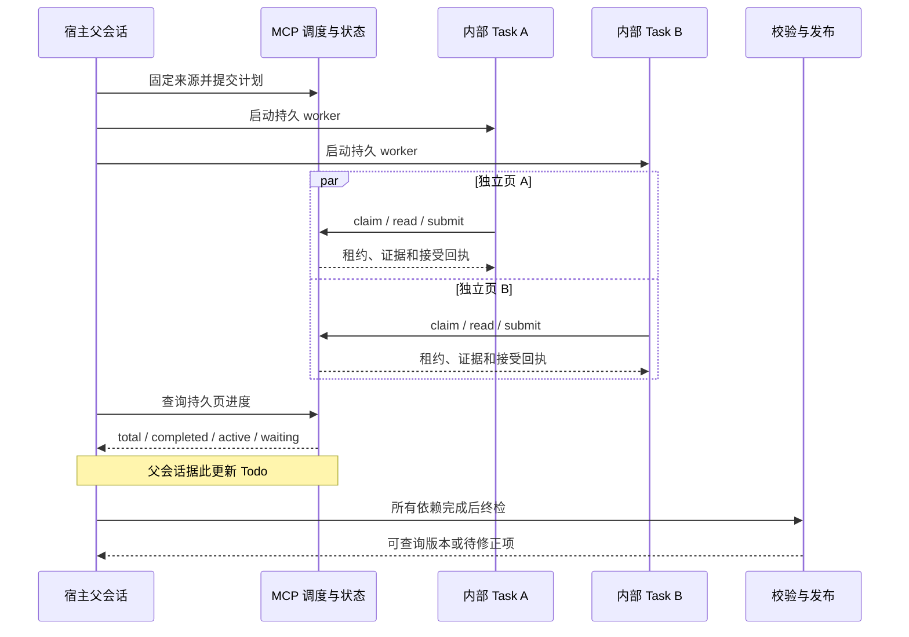
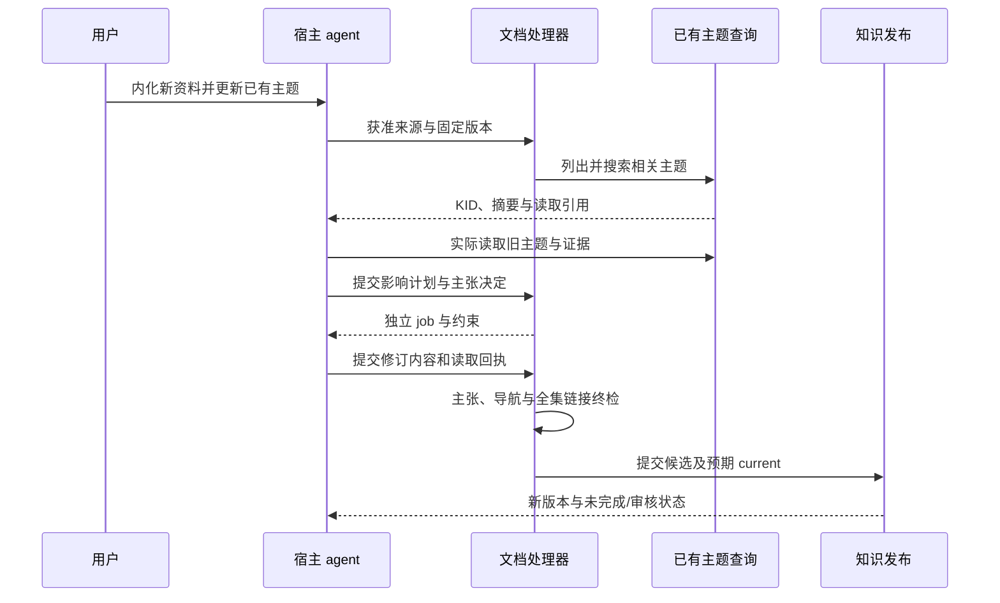
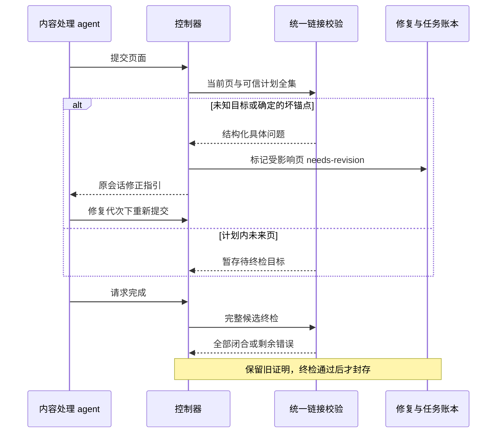
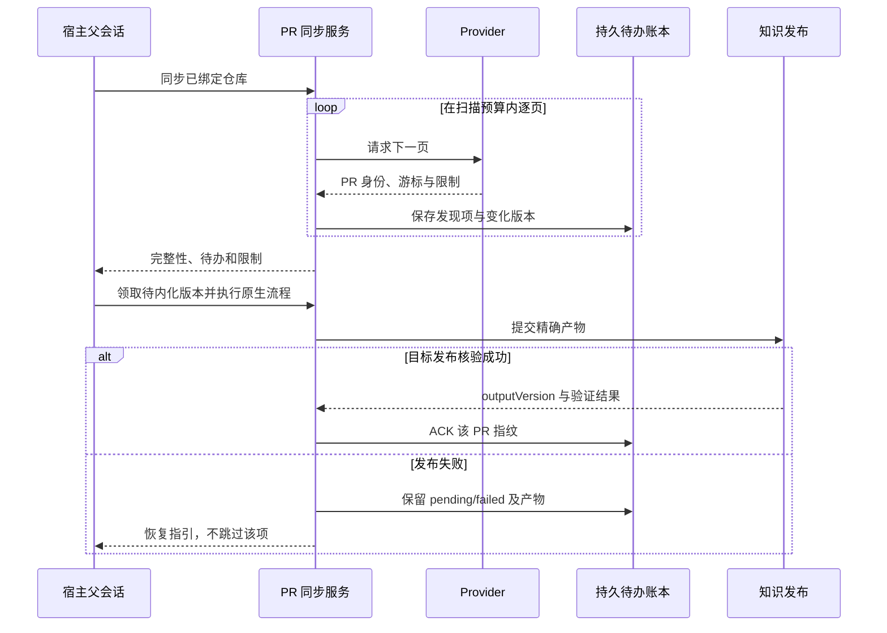
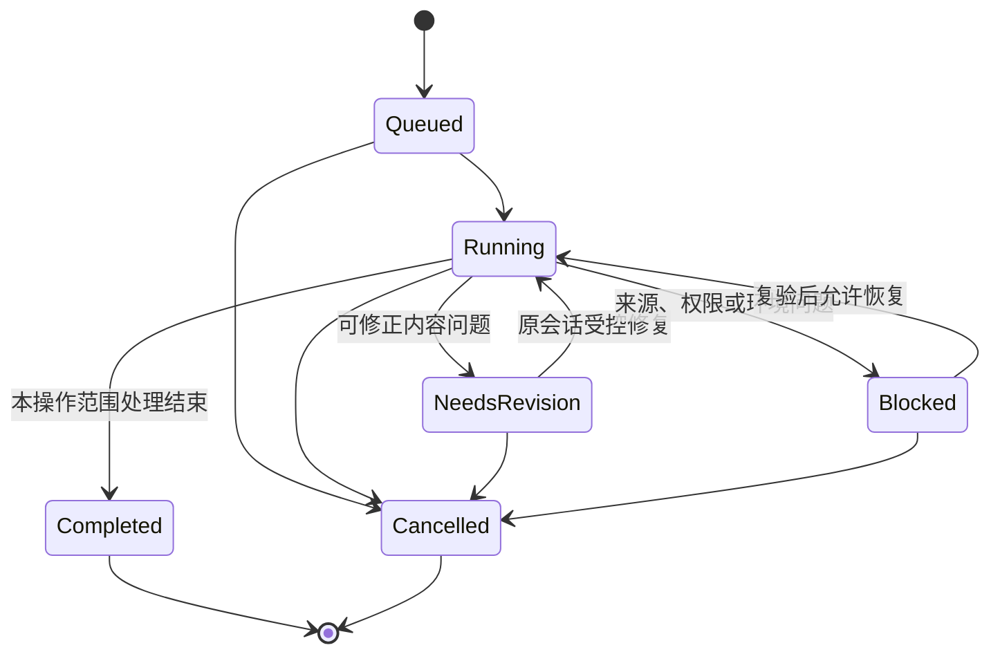

# KPBot Knowledge 项目设计文档

版本：讨论稿 2.0 · 日期：2026-11-11 · 定位：整个项目的功能与技术设计

## 1. 文档指南

### 1.1 本文回答的问题

本文把原先分散在总设计、CodeWiki、PR 主张、文档 digest、治理对齐和个人测试整改中的内容合并起来，说明平台提供什么功能、每一步采用什么技术、为什么这样做，以及怎样验证和处理异常。专项文档作为设计来源留存，阅读本篇无需先读完这些材料。

本次仅编写设计，不据此改变程序、运行配置或用户知识。新增设想供共同讨论，不能自动成为已交付能力。

全文按以下十章组织：

| 章节 | 主要阅读者 | 阅读后应能回答 |
|---|---|---|
| 文档指南 | 所有人 | 怎样区分事实、需求和建议 |
| 平台概述 | 使用者、产品负责人 | 这个平台提供什么价值 |
| 组件描述 | 使用者、开发者 | 系统由什么组成，各部分负责什么 |
| 需求分析 | 产品、开发、测试 | 必须满足什么要求，优先级是什么 |
| 系统架构设计 | 开发者、维护者 | 数据、状态、治理、检索和更新如何实现 |
| 接口设计 | 集成与开发者 | 操作输入输出是什么，如何兼容 |
| 性能可靠性安全设计 | 开发、运维、交付人员 | 并发、成本、故障、权限怎样控制 |
| 流程图与时序图 | 所有人 | 完整过程和组件交互是什么 |
| 验收测试用例 | 测试、使用者 | 怎样判定满足需求 |
| 异常处理分析 | 开发、维护者 | 问题为何发生、在哪里处理、怎样恢复 |

### 1.2 设计状态怎样标注

- **现有基础**：已经从源码找到对应机制，未自动意味着所有默认入口和实际安装均已通过。
- **交付要求**：来自用户确认及既有设计，完整交付必须满足。
- **待补齐**：已发现实现或用户链路缺口，需要修改并验证。
- **讨论提案**：本文新增或进一步明确的方案、参数和商业化扩展，可共同修订。

各章按目标设计展开，涉及重要差异时明确标注。第 4.3 节集中说明核查状态，第 9 章列验收方法。本文不把计划、源码提交、自动化测试和人工验收混为同一状态。

### 1.3 术语：避免把实现名称当作产品语言

| 名称 | 在本文中的含义 |
|---|---|
| 宿主 agent | Codex、CANNBot 等执行用户任务、提供模型和工具调用能力的 coding agent |
| Skill | 宿主发现平台入口、选择步骤和理解工具结果的操作指引 |
| MCP | 宿主调用 KPBot 服务的工具协议；服务保存状态并执行规则 |
| 内容编写与修订 | agent 读取证据、提出主题和主张、提交候选内容的过程 |
| author / producer | 旧源码中的“内容编写工具 / 生产端”；不是特指人类作者，也不等于人工审核者 |
| digest | 阅读资料并融入主题知识，包括查重、综合、修订、冲突和关系维护 |
| 中心知识仓 | 用户选择的知识目标仓，三类知识都保存到其中的 knowledge/ |
| KID / CID | 稳定知识身份 / 稳定主张身份；具体编码由实现协议管理 |
| 发布 | 将校验通过的输出提交为一个可消费版本；Git 提交、推送另记状态 |
| READY | 原生流程完成状态；不自动表示已人工审核、已激活或已推送 |
| DAG | 有向无环依赖图：先完成依赖页，再执行引用它的任务 |
| 租约与 fencing | 限时任务所有权，以及拒绝旧持有者迟到写入的代次检查 |
| CAS | 比较后交换：只有当前版本仍等于预期值，才允许提交新版本 |
| ACK | 对精确来源版本“已经核验并发布”的持久确认 |
| inventory / ledger | 完整观察项清单 / 对每项如何处理的账本 |
| FTS5 / BM25 | SQLite 全文索引扩展 / 根据词频、稀有程度和文档长度计算相关性的词法排名方法 |

上一版“作者流程”在本篇统一改称“内容编写与修订流程”。源码名称保留，方便定位实现。

### 1.4 设计依据及融合范围

| 依据 | 已融入本篇的内容 |
|---|---|
| [三域持续入仓总设计](https://gitcode.com/gcw_FzsXDb5x/kpbot-knowledge/blob/6c748009837658b65d79ec3f74f9abcf5f2dd29e/docs/superpowers/specs/2026-11-09-knowledge-delivery-convergence-design.md) | 中心目录、稳定身份、多来源知识、兼容迁移、统一入口与交付边界 |
| [CodeWiki 设计](https://gitcode.com/gcw_FzsXDb5x/kpbot-knowledge/blob/6c748009837658b65d79ec3f74f9abcf5f2dd29e/docs/superpowers/specs/2026-11-04-kpbot-codewiki-activation-parallel-design.md) | 仓库映射、项目激活、官方版本更新、两层调度、原子切换 |
| [PR 主张设计](https://gitcode.com/gcw_FzsXDb5x/kpbot-knowledge/blob/6c748009837658b65d79ec3f74f9abcf5f2dd29e/docs/superpowers/specs/2026-11-09-pr-native-claims-design.md) | 逐主张修订、来源角色、合并拆分、退休与继承证据 |
| [文档 digest 设计](https://gitcode.com/gcw_FzsXDb5x/kpbot-knowledge/blob/6c748009837658b65d79ec3f74f9abcf5f2dd29e/docs/superpowers/specs/2026-11-09-document-topic-digest-design.md) | 主题发现、影响计划、原生来源差异、维护待办和综合知识 |
| [CANNBot 对齐设计](https://gitcode.com/gcw_FzsXDb5x/kpbot-knowledge/blob/6c748009837658b65d79ec3f74f9abcf5f2dd29e/docs/superpowers/specs/2026-11-11-cannbot-alignment-discussion-design.md) | 审核、词表、适用条件、生产与消费边界；未决选项仍待讨论 |
| [个人测试整改设计](https://gitcode.com/gcw_FzsXDb5x/kpbot-knowledge/blob/6c748009837658b65d79ec3f74f9abcf5f2dd29e/docs/superpowers/specs/2026-11-11-manual-acceptance-repair-design.md) | 安装、中心落盘、不中断切换、并发进度、坏链恢复、仓库 PR 增量 |
| 本地 CANNBot Knowledge 固定版本调研手册 | OKF/Contract、Profile/Registry、写前检查、来源 inventory/ledger、检索与评测、维护收尾 |

OpenWiki 参考固定为 **0.7.2，commit 305599f8e44203f9ca6b74bb6b38eebaf0b0405e**。KernelWiki 借鉴来源记录、综合机制知识、派生查询的分层方式。

CANNBot 参考来自工作区 `My-docs/references/cannbot/`，手册声明基线为 `654f897d17c7a5749ac2fad4a686ef8d6f000f1c`。本轮读取了架构、格式、来源、摄入、查询、索引、更新、检查、交接、安装和维护模块。清单指向的原始快照当前不在本地，不能重新核验其 38 个源码条目；本文对 CANNBot 的描述属于该固定版本手册的调研依据，不冒充最新源码或运行验收。

## 2. 平台概述

### 2.1 产品目标与典型场景

KPBot Knowledge 是以本地优先、Git 可交付的知识资产为核心的平台。用户通过一个入口，把代码、PR/补丁和文档持续整理为可以查询、更新、追溯和共享的知识。

典型场景：先理解某 CRC 算子的实现，再读相关 PR 了解设计变化，随后内化技术资料补充限制条件，最后跨三类知识查询“这个实现为什么这样选，在什么条件下适用”。来源变化后，平台修订受影响主题，保留原有身份与历史。

| 类型 | 输入 | 主要产物 | 核心判断 |
|---|---|---|---|
| code-wiki | 固定版本的代码仓 | 导航、API、模块、机制、测试与代码证据 | 代码怎样工作，知识适用于哪个版本 |
| pr-wiki | PR、补丁、明确的提交与上下文 | 变更记录、综合机制页、主张与历史 | 改了什么、为什么改、证据支持到什么程度 |
| doc-wiki | 文档及其新版本 | 来源记录、主题知识、关系与维护记录 | 新材料应新增主题还是修订旧主题 |

平台提供知识生产和消费基础设施。编译、运行和性能测试仍由相应业务工具完成，平台保存其可核验结果及引用。

### 2.2 用户角色与部署形态

| 角色 | 能做什么 | 主要限制 |
|---|---|---|
| 个人知识维护者 | 绑定中心仓、接入来源、创建更新和查询 | 写入范围受实际绑定与权限控制 |
| 内容处理 agent | 阅读获准证据，规划和编写候选内容 | 不能自行扩大目录权限或冒充审核人 |
| 审核者 | 对精确修订批准、拒绝或指出条件 | 审核与生成分别记录 |
| 只读消费者 | 搜索、读页、读允许公开的证据 | 不默认获得生产工具和原始资料权限 |
| 管理员/维护者 | 升级、迁移、备份、治理与发行 | 管理动作需有预览、边界和恢复依据 |

**当前收敛范围**是单机/项目与多个知识仓的可靠协作。团队可以通过 Git 分发知识快照，或使用可选只读 HTTP 消费。多租户 SaaS、企业 SSO、集中计费和多机写入属于讨论提案，需要独立权限与部署设计，不能把本地文件保护等同于完整租户隔离。

### 2.3 平台的使用承诺

1. 下载后有统一安装入口，并能说明实际加载版本、Skill、目标目录和使用方法。
2. code、PR、document 连续处理，新增获准来源不要求日常重启 MCP。
3. 输出进入用户选择的中心仓，不默认进入来源仓或测试仓。
4. 一个父会话通过内部 Tasks 并行处理，进度与实际任务一致。
5. 更新以已有知识为基线，保留有效内容、证据、稳定身份和历史。
6. 可恢复的内容错误在原流程内修正，权限或证明问题明确阻断。
7. 自动校验、事实审核、人工验收和 Git 发布分别呈现。

## 3. 组件描述

### 3.1 组件边界与技术组成

| 组件 | 技术与方法 | 输入 → 输出 | 主要实现位置 |
|---|---|---|---|
| 对话入口 | 单一 Skill、随运行包提供的工作流说明 | 用户意图 → 领域与步骤 | `skills/kpbot-knowledge/` |
| 安装与接线 | Bash 引导、Node CLI、宿主配置适配、运行包清单 | 下载目录与 agent 名 → 配置、Skill、安装结果 | `install.sh`、`src/install.ts`、`src/unified/install-unified.ts` |
| 工具服务 | TypeScript、MCP SDK、Zod 严格输入校验 | 工具请求 → 结构化结果或错误 | `src/server.ts`、`src/unified/mcp-tools.ts` |
| 统一控制器 | 持久会话、状态机、事务、版本检查 | create/update 操作 → 可恢复领域执行 | `src/unified/controller.ts` |
| 来源管理 | 物理路径核验、来源策略、内容捕获、Git 版本核验 | 允许的来源 → 固定输入与读取边界 | `source-admission.ts`、`source-policy.ts`、`pr-capture.ts` |
| CodeWiki 处理器 | OpenWiki 内核适配、仓库调度、DAG 页依赖、租约 worker | 固定源码 → 代码 Wiki 候选全集 | `src/unified/codewiki/`、`src/kernel/` |
| PR 处理器 | 原生 v4 主张账本、逐项证据决策、主题修订 | 变更快照 → 机制知识与来源关系 | `src/domains/pr-claim-pages.cjs`、`pr-mechanisms.cjs`、`pr-fusion.cjs` |
| 文档处理器 | 主题目录、实际读取、影响计划、逐主张修订、来源处理账本 | 新旧资料与知识 → digest 候选 | `document-digest-planning.ts`、`document-claim-author.ts`、`document-lifecycle.ts` |
| 共享治理 | YAML 解析、JSON Schema/Contract 检查、Profile、词表、适用条件 | 页面及上下文 → 合规描述或具体问题 | `src/governance/`、`knowledge-query-policy.ts` |
| 身份与版本 | 稳定 ID、canonical JSON、SHA-256、别名、显式迁移 | 知识和主张 → 可定位的精确修订 | `knowledge-identity.ts`、`knowledge-claims.ts`、`knowledge-migrations.ts` |
| 发布与可见目录 | 不可变文件、清单、当前指针、CAS、物化视图 | 校验候选 → 已提交快照与可见 Wiki | `repositories/publication.ts`、`projection.ts` |
| 查询与消费 | 过滤、FTS5/BM25、分节读取、连接内句柄、只读传输 | 查询/引用 → 允许的知识与证据 | `query-controller.ts`、`query-mcp.ts`、`http-consumer.ts` |
| 运行观测与恢复 | 持久任务状态、事件、预算、错误分类、断点恢复 | 执行过程 → 进度、成本与恢复决策 | 控制器、各领域账本、CodeWiki task/page stores |

表中无目录前缀的 TypeScript 文件位于 `src/unified/`。实现混用 TypeScript、已有 JavaScript/CJS 领域内核，逐步适配，不以一次性重写内核作为统一入口的前提。

### 3.2 基础技术选型与理由

- **Node.js >=24.15.0 + TypeScript**：与现有内核和 MCP 接线一致，使用 Node 内置 `node:sqlite`，类型与运行时校验共同限制输入。
- **MCP SDK + Zod**：宿主无需绑定特定 UI；工具参数严格校验，领域状态仍由服务端决定。
- **Markdown + YAML frontmatter**：便于人读、Git 审阅和可移植消费；结构元数据用于筛选和治理。
- **SQLite**：保存单机任务、事务、租约及派生数据，降低部署依赖。SQLite 与文件发布必须有恢复协议，不能假设跨两者存在天然事务。
- **Git + 内容摘要清单**：记录来源与知识版本，支持差异审核和分发。摘要提供完整性，身份认证需要额外可信来源或签名。
- **marked 等 Markdown 解析器与统一链接解析**：按语法识别标题、链接、相对路径和锚点，避免用单条正则处理整篇 Markdown。
- **宿主内部 Tasks**：复用宿主模型和并发能力；MCP 调度并验证任务，避免另建无限制模型进程群。

### 3.3 与 CANNBot Knowledge 的取舍

| 细节 | CANNBot 固定版本手册描述 | KPBot 的选择 |
|---|---|---|
| 格式治理 | Python Contract 共用 Schema/Profile/Registry | 保留同一事实源思想，以现有 JS/TS 治理模块贯穿生产、发布和查询 |
| 通用摄入 | 查重、读原卡、策展、写前检查、语义复核、维护收尾 | 同样分层；增加原生主张、读取回执和当前版本提交协议 |
| 固定源码覆盖 | tracked inventory、逐项 ledger、批次核验 | 保留“全部观察项都有决定”，应用到来源差异、PR 积压和文档待办 |
| 检索存储 | SQLite 普通表和自定义 postings | 当前采用请求内 SQLite FTS5，具体算法见 5.7 |
| 检索评分 | 字段 TF 加权与信任降权；默认非完整 BM25F | 当前采用 BM25 加权、查询词覆盖与路径偏好，评审资格在排序前明确过滤 |
| 维护过程 | 导航、日志、Lint、索引 build/verify、目标 Query、聚合检查 | 将相同收尾职责接入领域完成和发布；不能只依赖 Skill 文字提醒 |
| 安装角色 | consumer / contributor 分工 | 同样区分消费与生产能力；不复制 CANN 专用平台和 VV/CV 分类 |
| 长程任务 | decision → 检索回执 → ready → outcome | 借鉴证据与结果分开；复用现有回执，不再造一套平行账本 |

## 4. 需求分析

### 4.1 功能需求

P0 表示可靠个人使用和对外交付前必须解决；P1 表示扩大维护和商业支持前应具备；P2 为可选演进。优先级是本文收敛建议，可讨论调整。

| 编号 | 优先级 | 需求与可观察结果 |
|---|---|---|
| FR01 | P0 | 一个安装入口支持下载仓与发行包，展示实际版本、Skill、中心仓和操作示例 |
| FR02 | P0 | 三域共用中心仓根；来源仓不被生成过程改写；正确绑定知识远端 |
| FR03 | P0 | 统一 create/query/update 语义，按来源与已有会话分派原生流程 |
| FR04 | P0 | 同一服务连续执行三域任务；新增明确获准来源安全生效 |
| FR05 | P0 | CodeWiki 固定来源版本，按页生成，更新后原子切换查询版本 |
| FR06 | P0 | PR/补丁逐主张维护，保留变更事实、推断、测量和适用条件的区别 |
| FR07 | P0 | 文档 digest 跨文档/来源发现已有主题，支持补充、纠错、合并与争议 |
| FR08 | P0 | 仓库 PR 首次完整观察并明确积压；后续识别新增/变化且不跳过失败项 |
| FR09 | P0 | 一个父会话内部多 Tasks；真实重叠、预算约束、进度和 Todo 同步 |
| FR10 | P0 | 未知坏链尽早报错，计划内未来链接延迟终检；原会话受控修复 |
| FR11 | P0 | KID/CID、来源版本、页修订和发布版本分别记录，历史可读 |
| FR12 | P0 | 生成、更新、发布、索引和查询执行同一份治理字段语义与词表 |
| FR13 | P0 | 跨域查询返回具体版本、来源、适用条件和审核状态；候选显式读取 |
| FR14 | P0 | 本地完成、可查询、事实/人工审核、Git 提交和推送分别报告 |
| FR15 | P0 | 兼容旧知识，迁移有预览、身份保持、冲突检查与恢复依据 |
| FR16 | P1 | 独立只读消费者能核验发布快照，不继承生产权限 |
| FR17 | P1 | 耗时、token、重试、并发与产物 trace 可以逐阶段对账 |
| FR18 | P1 | 提供安装诊断、备份恢复、发行清单、许可证、支持边界和升级说明 |

### 4.2 不应隐含的产品行为

仓库绑定不等于后台无限扫描；发现更新不等于已生成知识；文件写入不等于内容正确；READY 不等于人工通过；生成知识不等于自动推送。来源无权限、范围不明确或实际无新证据时，应返回相应状态。

对商业交付而言，“用户能自行修正知识”也需要明确支持。**讨论提案**：提供受控编辑入口，先生成差异和影响预览，经相同治理、证据与发布流程提交。直接编辑可见 Markdown 可作为输入草稿，但不应静默绕过当前版本和主张账本。

### 4.3 当前能力与缺口快照

本轮核查已看到 `1b82c19` 的文档来源运行时接入，以及 `8c84461` 的安装脚本与引导提交。开发工作树仍在变化，本文不把它们等同于真实下载包或宿主验收通过。

| 领域 | 现有基础 | 当前仍需验证/补齐 |
|---|---|---|
| 安装 | 已新增 `install.sh`，支持单个 cannbot/codex/claude 参数和引导文字 | 与严格安装接线的一致性、完整版本检查、旧配置处理、包指纹、真实握手；逗号多宿主尚非该脚本能力 |
| 运行时来源 | 已新增 `kpbot_sources_admit` 与策略重读 | 完整权限证明、重载竞态、撤权与在途任务快照；不能仅凭模型自述用户授权 |
| 中心落盘 | 共享仓根、可见投影、托管 CodeWiki 工作区 | 默认安装的 mapping、identity、project/worker 接线，逻辑目录与迁移对齐 |
| 并发与进度 | 页租约、worker 协议、文档 per-job 机制 | 公开控制器仍需避免跨 await 长事务；批次页数聚合与真实宿主 Tasks 证据 |
| 文档修复 | 共享链接解析器、持久会话、部分恢复 | 计划全集 inventory、封存后的受控修复代次、取消和旧流程兼容 |
| PR 持续同步 | 单 PR/补丁/提交与原生主张历史 | provider 分页、仓库级版本指纹、待办和发布后确认账本 |
| 查询治理 | 统一查询、review、适用条件、词表、公开消费 | 实际安装接线、旧数据边界、规模性能和默认模式完整验收 |

个人环境曾加载 0.3.0 包，而开发源码包为 0.4.8，说明必须核对“宿主实际运行什么”。旧固定 oracle 原始目录缺失，原 domain-parity 对应门禁继续受阻；新基线测试不能替代其历史结果。

### 4.4 商用交付需要增加的能力

| 优先级 | 缺口/风险 | 设计应增加什么 |
|---|---|---|
| P0 | 安装可能保留旧配置，局部失败仍显示完成 | 分阶段结果、非零失败、所有权检测、精确包绑定、实际宿主握手 |
| P0 | 目录正确但默认能力未接通 | 安装产物功能自检：三域、身份、托管工作区、worker、查询策略 |
| P0 | 恢复依赖用户重启、删锁或复制来源 | 原会话修复、租约 fencing、幂等提交、明确退出与重试路径 |
| P0 | 新来源接入可能扩大权限或混用旧策略 | 独立操作授权、请求级快照、策略代次、变更前排他栅栏 |
| P0 | 内容、索引、可见投影或 Git 状态互不一致 | 发布恢复账本、最后提交指针、派生视图修复、推送预览 |
| P1 | 升级可能让历史知识失效 | 格式兼容矩阵、迁移 dry-run、真实旧数据回归、备份恢复演练 |
| P1 | 耗时与 token 无法解释或控制 | 计费口径、任务树、重试/缓存统计、用户预算与取消 |
| P1 | 缺少内容质量与范围回归 | 固定问题集、来源事实抽查、冲突样本、版本适用测试 |
| P1 | 发行依赖、许可证和完整性难以复核 | 依赖锁、SBOM/许可证清单、发行摘要；签名验证作为发布链增强提案 |
| P2 | 团队审批和集中管理 | 审核队列、组织策略、可审计角色绑定；不直接复用本地信任假设 |

## 5. 系统架构设计

### 5.1 分层与依赖方向

采用“宿主编排 → 统一应用服务 → 三域生命周期 → 共享治理/身份/发布 → 本地存储”的分层。只读消费通过查询端口访问发布结果，不直接调用生产控制器。



处理器不能由模型参数注入任意文件系统后端或 authorizer。共享模块也不应读取宿主会话全文；需要的数据通过明确端口传入。

### 5.2 目录、数据模型与权威关系

中心仓根记为 C，来源仓记为 S，私有控制目录记为 P，安装包目录记为 I。**三个 store root 都指向 C**，程序再追加 `knowledge/<类别>`；把 store 配成 `C/knowledge` 会产生错误嵌套。

```text
C/knowledge/
├── code-wiki/
│   └── <可信仓库名>/codewiki/    # 保留 OpenWiki 风格的仓库内页面组织
├── pr-wiki/
│   ├── sources/                # 变更来源描述
│   ├── wiki/                   # 按机制组织的综合知识
│   └── queries/                # 派生查询材料
└── doc-wiki/
    ├── sources/                # 文档来源描述
    └── wiki/                   # 主题及其导航，按实际内容规划
```

这是逻辑目录合同。现有投影可见路径与 `.kpbot` 历史机制不能直接被当作已经满足所有逻辑分层，必须通过 layout 配置与显式迁移收敛。公开快照、索引等额外机制文件按各自格式放置，不混入主题正文。

| 对象 | 关键字段/关系 | 权威性 |
|---|---|---|
| Source | 来源身份、允许根、类型、可见性、provider、版本 | 声明依据与读取范围 |
| Knowledge | repositoryId、KID、当前定位、别名 | 主题身份；名称和路径可变 |
| Claim | CID、statement、kind、status、evidence、争议关系 | 明确可修订的知识主张 |
| Evidence | 来源版本、资源位置、行/节范围、内容摘要、读取回执 | 说明主张依据，不自动证明推理正确 |
| Page revision | KID、正文摘要、来源集合、claimsRevision | 固定页面的一次精确修订 |
| Publication | 文件清单、摘要、治理 pin、来源、输出版本 | 固定一批可消费结果 |
| Query index | 发布版本、检索算法、字段/词表指纹 | 派生数据，可重建 |
| Session / Job | 固定输入、计划、预算、期限、租约、操作序号 | 执行与恢复状态 |
| Review / Applicability | 精确目标修订、评审方式、身份、裁决、条件 | 只作用于被绑定版本 |

KID 现有实现使用 `kpi_` 加 UUID 的独立身份。页修订通过 canonical JSON 与 SHA-256 绑定正文、来源和主张修订。路径迁移保留 KID 和别名；CID 按领域协议维护，不能随排版重新分配。

一项主题可由多个来源支持，一个来源也可贡献多个主题。canonical current 是同主题当前知识，不是“一份来源一张新卡”。检索索引、目录导航和可见投影都不能替代发布版本权威。

### 5.3 安装与运行时配置

**目标方法：预检 → 准备运行包 → 绑定中心仓 → 写宿主配置 → 实际握手 → 展示引导。**

1. 解析真实脚本/包位置，不依赖用户当前工作目录；支持空格与中文路径。
2. 校验完整 Node 版本 `>=24.15.0`。当前脚本仅比较 major 的方式不足以覆盖 package engines。
3. 从锁定依赖构建或直接采用发行包，记录源提交、包摘要、dist/Skill/协议摘要。按内容摘要创建安装目录，保留在用旧包，验证成功后切换。
4. I、P、C 保持要求的物理边界，托管工作区在 P 中。对已有非空 C 做显式接入预览，拒绝不明身份或历史冲突。
5. 宿主配置通过各自格式解析器更新；只修改本安装拥有的条目，保留其他 MCP、注释和用户配置。
6. 实际启动预期入口并进行 MCP 握手与必要能力检查，明确宿主是否已加载。配置失败不能用一行 warning 后继续报告“安装完成”。
7. 展示 create/query/update 示例、目标 C、实际版本、审核与推送边界。

**待补齐的安装审查点**：现有新脚本保留已有 stores/runtime 文件、按版本目录替换包、通过 shell 插值生成部分配置，且部分失败仅提示警告。需要替换为结构化 JSON/TOML 写入、文件所有权与内容比较、可重入分阶段安装、临时目录和精确包校验。安装器不能因为标题写“一键安装”就跳过这些条件。

**讨论提案：运行时诊断接口**返回加载版本、包摘要、Skill 摘要、协议、能力清单、中心仓身份和脱敏配置状态。它用于发现旧包/旧 Skill 遮蔽，不返回凭据或私有来源正文。

### 5.4 来源准入与不中断使用

SourcePolicy 描述能读取的来源，StoreRegistry 描述目标仓。两者分开校验：可读源码不等于可写任意知识仓，可读发布知识不等于可读私有原文。

文档来源现有准入限制为受支持的 Markdown、plaintext、YAML 及明确文件清单。PDF、Office、网页抓取需要独立转换器、版本捕获和许可证策略，不能宣称通用输入已经覆盖。

**安全重载目标方法：**

- 每个操作开始固定策略代次和来源输入，操作内使用同一快照。
- 普通独立内容任务持有可并发读取的权限代次；来源变更在文件替换前获取排他变更栅栏。
- 新策略完成物理根、所有权、来源与控制目录分离等检查后才原子替换。
- 在途任务遇到撤权、输入漂移或目录身份变化时停止交付，不把旧读取许可延续到下一请求。
- 长轮询不得无限占用变更栅栏，变更冲突返回有界 busy/retry。

`kpbot_sources_admit` 已加入，但工具描述中的“仅当用户明确指定文件时调用”需要由宿主可信意图或 operator 接口支撑。**讨论提案**：宿主侧形成范围明确、短期有效的操作许可，或由受信 CLI 完成准入；不以模型填写 `authorized:true` 作为授权依据。仅凭提示文字约束存在不足。

### 5.5 三域处理方法

#### 5.5.1 CodeWiki：版本固定、依赖计划、按页生产

1. 使用 canonical repository identity、允许的远端/ref 和精确 commit 固定来源。校验工作区与版本，保留来源仓用户修改。
2. 在托管工作区准备源码；读取 tracked inventory 和必要符号，形成有范围的页面计划。
3. 页面节点含路径、依赖、证据范围和预算；检查重复路径、未知依赖和循环。
4. 父会话启动内部 Tasks，worker 通过页租约领取任务。读取工具支持 `repo://...#Lx-Ly` 范围与编号文本，正文证据仍绑定原始文件。
5. 提交草稿和 Claims，经单页预检后接受；父会话根据持久状态汇总。
6. 全集通过后发布候选版本，按项目范围原子切换激活指针。

两层调度分别限制仓库数与页面数，且共同受全局额度限制。项目激活列表绑定 sourceId，项目 A 的查询不得自动混入项目 B 的代码知识。

更新以已记录 commit 与新官方允许版本比较，映射受影响页。相同输入且完整验证的版本可以 noop；缺旧版本时明确受阻，不能猜 `HEAD~N`。

#### 5.5.2 PR：逐主张修订与仓库增量

原生 v4 复用已有 begin/plan/read_evidence/submit/check/finish，保留旧协议读取，不让模型选择更宽松协议。计划对输入 inventory 逐项标记 create/update/merge/split/deprecate/skip/defer 等决定。

编写阶段读取旧主张及原始证据。保留、修订、撤回、争议和新增均需显式决定；继承的事实不能仅因旧正文存在就静默获得新证据。合并/拆分需记录身份和退休关系，防止旧主题仍作为当前推荐出现。

**仓库级 PR 同步待补齐，推荐方法如下：**

- Provider 端口负责仓库身份、分页、PR 元数据、body、base/head、diff 与必要状态。首期接已支持的 GitHub PR，其他 provider 明确返回 unsupported。
- 初次遍历完整观察到的历史分页，处理预算与扫描预算分别限制。分页未尽、API 截断或 diff 过大必须返回 incomplete 和剩余范围。
- 指纹至少考虑 PR 固定身份、base/head、正文、diff 和相关元数据摘要。`updated_at` 用于发现线索，不能代替内容版本。
- 后续扫描采用重叠窗口，并复查跟踪中的 open/reopened PR；对历史已关闭 PR 的延迟编辑，周期性分段重扫或显式全量对账，避免只追最新时间漏检。
- 新/变化版本进入持久待办，原生处理完成且正确目标发布核验后 ACK。扫描游标可以前进，但未 ACK 项必须独立保留。
- 分页本身不是数据库一致快照，应记录 scan 起止时间、provider 限制和对账状态。完整指“本次观察覆盖完成”，不承诺扫描期间上游从未变化。

推荐账本包含 repository、scan、PR identity、fingerprint、pending/processing/failed/published、outputVersion 和 ACK。对 `(repository, PR, fingerprint)` 建幂等约束，防止重复内化。

#### 5.5.3 文档：先发现主题，再做 digest

处理顺序为：固定资料版本 → 获取有界主题元数据 → 检索相关 KID → 实际读取旧主题和证据 → 制定影响计划 → 分配独立任务 → 修订主张与关系 → 全集校验。

主题发现必须覆盖根主题和嵌套主题，不能只查 `sources/<documentId>/`。文档身份应包含来源命名空间，不把不同来源中的同名 documentId 当作同一份资料。

来源差异包含新增、修改、删除、重命名；每项有处理或暂缓决定。删除来源后，先判断哪些主张仍有其他证据，不能直接删除整项知识。延期待办在下次更新中继续可见，不因本批结束而丢失。

每个修订计划列出读取依据、受影响 KID/CID、处理动作、保留内容、冲突及导航关系。独立文档任务可以并行，但同一主题并发修改必须通过 revision/CAS 合并或返回冲突。

**示例**：资料 A 说默认并发为 8，资料 B 说某新版本为 16。先核对默认值/上限/实验条件和版本，再修订适用范围；不能按更新时间直接把所有 8 替换为 16。证据不足时保留争议或 draft。

### 5.6 共享治理：数据声明、执行检查、语义评审

治理是三层组合：Schema 检查形状，Profile/Registry 检查分类与受控值，Contract 检查组合与跨文件关系。语义评审另核来源是否支持主张。

当前公共 frontmatter schema 要求 `type/profile/title/description/domains/technology/scope/tags/status/sources/created_at/updated_at`，可选字段包含 platforms、aliases、verified、review_state 等。平台不能把 CANNBot 的字段数量、标签数量或平台值直接复制成自身通用规则。

| 规则 | 技术方法 | 执行点 |
|---|---|---|
| 字段合法 | YAML 安全解析、重复 key 拒绝、schema/白名单 | 读元数据、写前、发布、索引 |
| Profile 与路径适配 | Profile 声明与统一 contract 推导/验证 | 规划、提交、迁移 |
| 标签与平台 | Registry、别名规范化、废弃项诊断 | 生成指引、校验、查询过滤 |
| 时间与生命周期 | created_at 保持出生时间，updated_at 为实际修订；状态关系核验 | 更新、退休、发布 |
| 来源与证据 | 精确版本、资源、范围、回执和内容摘要核验 | 编写、终检、读取 |
| 适用条件 | 明确环境字段和断言；match/unknown/conflict 分开 | 条件提交、查询及读回 |
| 审核 | 绑定 repositoryId、KID、页/主张修订和评审方式 | approve/reject、查询资格 |

规则更新必须使相关派生索引失效或重建，并明确旧内容的兼容方式。当前写入执行最新可信规则；历史只读核验原版本，不加载历史目录中的规则代码。

治理指引按领域、Profile 和动作投影给 agent，只提供相关字段、约束和例子，减少整套规范重复进入上下文。程序仍执行全部适用检查。

**页面内容组织建议**：每页先给出结论和适用范围，再说明机制、限制/反例、证据位置与相关主题。代码页补充入口与调用关系，PR 页补充前后行为和变化原因，文档主题页补充综合结论与来源分歧。该建议按 Profile 细化，不要求为统一排版重写所有历史页；结构化 Claims 与证据边车负责保留可核验关系，正文负责让人读懂。

### 5.7 查询方法、索引与审核隔离

**当前实现的具体方法：**

1. 先按项目、repository/source、知识类型、可访问性、Profile、标签、平台、内容状态和审核视图筛选。
2. 从已授权且核验的知识页构造候选语料；不扫描原始源码树兜底。
3. 解析 Markdown，按二级标题形成检索节，保留标题、正文、行范围和锚点，单独处理引言。
4. 统一做 NFC 规范化、英文标识/驼峰/分隔符拆分，并补充中日韩字符及相邻二元片段，改善中文夹代码符号的召回。
5. 在请求内 `:memory:` SQLite 建 FTS5：`title, description, heading, prose, identifiers`，tokenizer 为 `porter unicode61`。
6. 使用 `bm25(units,8,4,6,1,3)`；排序还考虑来源路径偏好和查询词覆盖，随后以稳定顺序打破同分。该权重是当前实现值，尚非已证明最优值。
7. 返回候选节和读取句柄。agent 需实际读取页或节，按缺口补查，最后给出证据、版本与限制。

代码依据为 `src/domains/query-rank.cjs`。CANNBot 手册中的自定义 TF 字段公式与此不同，不能混写成同一算法。

默认 reviewed 视图只纳入满足当前审核资格的精确修订；candidate 必须显式选择。人工、模型、自动化评审分别记录，任何一种“运行成功”都不能冒充另一种。内容状态 stable 与审核资格也要分别解释。

**性能演进提案**：请求内建索引在语料增长时会重复解析与建表。先建立按授权语料、输出版本、词表、排序版本绑定的受控缓存，或构建同样语义的持久 FTS5；查询仍做授权与当前指针复验。选择依据见第 7 章基准，不先引入向量库。

**探索提案**：若固定问题集显示词法召回不足，再试 embedding + 词法候选融合（如 RRF），必要时加重排。必须比较质量、延迟、token/费用与隐私；不能在未经验证时宣称具备语义检索或 GraphRAG。

### 5.8 发布、一致性与迁移

现有机制使用不可变输出、摘要清单、current/CAS、公开索引及可见投影。推荐的完整提交与恢复协议为：

1. 在 staging 写候选，完成字段、主张、证据、链接和允许公开内容检查。
2. 固定清单与摘要，将不可变输出准备到最终位置；校验实际字节与清单一致。
3. 写持久 PREPARED 发布意图，记录旧 current、目标输出和预期代次。
4. 通过 CAS 提交当前索引；同一逻辑提交中保证 KID head、退休关系和输出引用一致。
5. 更新可见视图与派生索引，记录 COMMITTED；中断时根据发布意图和 current 对账修复。

PREPARED/COMMITTED 是收敛跨文件/SQLite 发布恢复的**设计要求**，并非宣称当前已有统一的这两个字面状态。POSIX rename 只保证单路径原子替换，不能保证整批文件或跨 SQLite 的原子性。内容地址输出与最后提交指针使旧版本始终可用；若要人直接读多页目录也有全集一致性，应采用快照目录+原子目录指针，或明确可见视图修复中的状态。

Git 提交/推送通过独立预览：核对 C 的物理身份、origin/push URL、允许文件和已有 staged/待推送历史。不把其他来源仓、测试仓、无关提交顺带推送。

迁移需区分路径调整、schema 升级、领域协议升级和来源重新绑定。先 dry-run 给出受影响 KID、别名、旧协议、冲突、可回退条件，再执行。旧证明保留原字节；不能重算 hash 把旧历史伪装成新协议产物。

### 5.9 固定流程脚本化：减少对提示词执行顺序的依赖

本节是结合当前 Skill、原生服务和 CANNBot 固定版本手册形成的设计判断，不代表已完成改造。核查已看到 `551cd6f` 的 PR 默认语言与 `kpbot_pr_sync_status`，以及文档作业进度的新增代码；此前状态快照不能替代这些新提交的独立验收。

#### 5.9.1 什么应该由程序负责

判据是：给定可信输入，结果能否由明确规则计算和验证。能确定的任务由程序负责执行与持久化；需要理解技术含义的部分由 agent 提出决定，程序核对结构、覆盖、证据引用和权限。

这里的“脚本化”以共享 TypeScript/Node 模块和持久状态机为主，Bash 只负责引导；CLI 与 MCP 调用同一业务服务。不把所有机制搬成 shell，也不为每个内部步骤新增 MCP 工具。

| 流程 | 当前基础/提示词负担 | 推荐固化方法 | agent 保留的职责 |
|---|---|---|---|
| 安装与环境诊断 | 已有脚本，仍需判断旧配置、实际宿主版本及部分失败 | 版本/包/配置所有权预检，结构化配置写入，分阶段结果，真实握手 | 用户目标和无法推导的宿主选择 |
| 目标仓与来源映射 | 已有 mapping/registry，但 Skill 仍要求先查、确认和选路径 | prepare 自动解析可信映射和实际仓身份；歧义返回候选，禁止猜目标 | 在实质歧义时请用户选择 |
| 新建/更新/恢复/noop | 已有部分控制器判定，提示仍列多套操作顺序 | 服务按来源版本、协议、现有会话和已发布状态返回唯一合法下一步 | 纠错目标、变化的知识范围 |
| 来源与证据准备 | 已有读取和回执机制，模型仍常需复制 ID、角色、摘要 | 任务上下文绑定已分配来源；有界分页/批读、完整性和角色检查，自动注入非业务字段 | 选择补充证据、理解实际读到的内容 |
| 固定版本差异与覆盖 | 已有 inventory/变化计划；需模型逐项提交决定 | 自动生成增改删重命名清单，对每项检查 ingest/noop/defer/exclude 账本闭合 | 判断变化影响哪些主题，是否合并/拆分 |
| KID/CID、时间与正文渲染 | 部分领域已经程序生成，无需再造 | 复用现有分配器、渲染器、schema；保留 created_at，核验词表和来源关系 | 标题、解释、主张和合理分类建议 |
| 内部 worker 循环 | 自动续租已在 host-bridge；领取/等待/退出等仍有长提示 | 调度器/宿主适配器管理容量、等待、退避、取消、丢失 worker；产物按真实回执接受 | 研究与创作；缺宿主 API 时仍需父会话发起内部 Tasks |
| 进度与 Todo | 已有页/作业状态，Skill 仍要求每次手动更新 | 持久状态聚合，单调 revision 与事件；有宿主接口时直接更新 Todo | 解释阻塞与用户沟通，必要时转述进度 |
| 坏链与机械修复 | 已有共享解析器，需计划全集和受控返工接线 | 自动定位页/目标/锚点，唯一可信映射可预览修复；重验后提交 | 多个可能目标、语义错误和遗漏内容的修订 |
| PR 首次和增量同步 | 新 status 仅查看已配置 PR 快照，未覆盖远端发现 | provider 分页、指纹、持久待办、重叠对账、发布后 ACK，自动跳过已确认版本 | 提炼每次变更的机制和适用条件 |
| 完成收尾 | 已有 complete、发布和检查器，父会话仍按提示逐项回读 | 一条可恢复流水线执行覆盖核验、治理、全集链接、提交、索引一致性和精确版本读回 | 对内容正确性和质量作独立评审 |
| 失败重试与恢复 | 已有原生预算、租约、CAS 和部分恢复路径 | 分类错误、有界退避、状态对账和幂等重试；封存修复保留历史 | 处理需要新解释/新证据的错误 |
| 报告、日志与成本 | 任务数据已存在，最终摘要仍容易手抄 | 从真实事件生成数量、阶段耗时、token 口径、版本、未完成项和脱敏报告 | 用户可读的结论、原因和取舍 |
| Git 发布 | 有目录与映射约束，仍需统一发布接线 | 已授权范围内的 preview/apply、允许文件与待推历史核验 | 用户授权与无法自动裁定的冲突 |

完整读取回执说明系统交付了哪些字节，不证明模型理解正确。任务数量和租约数也不能证明宿主真的启动了模型子任务；真实父子会话与时间线仍需保留。

#### 5.9.2 从 CANNBot 借鉴什么，不照搬什么

固定版本手册中的关键做法是：`knowledge_ingest.py` 写前调用 Contract，`reference_inventory.py verify` 核对来源清单，`knowledge_index.py build/verify` 构建并验证派生索引，`check.sh` 聚合检查，`retrieval_state.py` 和 `retrieval_outcome.py` 校验复杂任务的证据状态链。

这些脚本负责可计算条件；主题策展、合并、冲突、来源支持程度和技术审核仍由 agent/人判断。手册明确通用 create 本身不完成日志、索引和发布，全流程也并非已证明存在全局自动调度。应借鉴其确定性边界，再把 KPBot 已有模块接成可靠收尾流程，而非逐字复制命令、评分或 CANN 分类。

KPBot 已有 `scripts/check.mjs`、linked checks、原生 complete 和发布核验。应区分软件发行检查与单批知识的收尾：前者验证源码/包/回归，后者验证本次精确产物。复用公共检查，不让每次文档内化都运行全软件发行测试。

#### 5.9.3 推荐执行模型与接口收敛

```text
可信请求
  → prepare：解析来源/目标、版本、已有任务、规则和机械差异
  → next：计算就绪工作，按宿主能力分派
  → agent：实际读证据、提出知识结构与主张修订
  → submit：严格校验，接受或返回具体修正项
  → finalize：覆盖/治理/链接 → 不可变提交 → 索引核验 → 精确版本读回
  → report：从账本生成结果、成本和缺口
```

这是业务服务的设计分工，不是新增六个同名 MCP 工具。主会话保留少量公开操作，worker 使用角色限定协议，管理动作通过受控 CLI；内部 NFC、哈希、CAS、索引构建等不单独暴露。

宿主内部 Tasks 的创建与 Todo 写入取决于宿主实际 API。MCP 服务不能凭空操控宿主会话；有接口时由适配器完成，无接口时保留最小启动/展示提示，并如实报告降级，不能改成多个独立 CANNBot CLI。

**优先顺序建议**：先固化目标/上下文准备、完成收尾、错误恢复和真实进度；接着完成 PR 分页与 ACK；再完善宿主 Tasks/Todo 适配及最终报告。主题组织、事实解释、冲突裁决与独立评审继续保留模型参与。新增语义评审调用应在既定授权和预算内，不以 finalize 自动宣称人审或自动推送。

## 6. 接口设计

### 6.1 对话入口与 API 分
create/query/update 是产品语义，当前没有必要强行改成同名的三个万能底层工具。对话入口先路由，再调用已有严格协议；新增外层操作视图可统一呈现状态，但不应丢失各领域证据。

| 用户表达 | 路由信息 | 工具链 |
|---|---|---|
| 为仓库生成/更新 Wiki | sourceId、官方版本、项目激活范围 | CodeWiki update/begin/plan/页面工作/finish |
| 整理 PR 或补丁 | 获准 sourceId、变更快照、已有主题 | start → action → complete/resume |
| 内化资料并更新主题 | 文档清单、版本、相关知识 | 来源准入 → start → digest/actions → complete |
| 查询机制 | 项目与知识范围、条件、审核视图 | knowledge_search → l k i mknowledge_read/read_many |
| 推送知识 | 中心仓身份、目标远端、允许差异 | 独立发布预览与执行；待统一接线 |

公共工具名、参数 schema 和错误码随协议版本管理；PR 现有生产接口中的 `type:'kernel'` 表达 PR/变更域，对用户统一显示 pr-wiki，不把内部别名误说成 Linux 源码类型。

### 6.2 现有主要 MCP 接口

| 接口 | 关键参数 | 结果与限制 |
|---|---|---|
| `kpbot_sources` | 无 | 已配置来源；列出身份不增加权限 |
| `kpbot_sources_admit` | sourceId、roots、visibility、documents | 文档准入结果；仅限明确来源，权限边界见 5.4 |
| `kpbot_start` | type、sourceId、mode、force 等 | 固定会话/输入与下一步指引；可能返回 noop/resume-required/migration-required |
| `kpbot_action` | sessionId、action、input | 原生读证据、计划、提交和检查；action 随会话协议固定 |
| `kpbot_complete` | sessionId | 原生完成与中心存储结果；同步失败保留原会话 |
| `kpbot_resume` / `kpbot_status` | sessionId | 恢复/检查，预算与期限不重置 |
| `kpbot_codewiki_update` | 可选 sourceIds | 创建维护批次，限当前项目范围 |
| `kpbot_codewiki_status` | batchId、waitMs | 仓库/运行进度；等待上限当前为 30 秒 |
| `kpbot_codewiki_work_status` | runId、waitMs、可选 workerId | 页状态与该 worker 已接受回执 |
| `kpbot_codewiki_claim_page` | runId、workerId、ttlMs | 页面任务与租约，或暂无可领任务 |
| `kpbot_codewiki_heartbeat` | 原租约 | 续租；失效 token/attempt 不可复用 |
| `kpbot_codewiki_read_source` | lease、resource 或 resources、format | 限量源码读取，支持编号与批读 |
| `kpbot_codewiki_write_draft` / `submit_artifact` | 领域 schema 与租约 | 写候选/提交 Claims，返回 accepted 或修正问题 |
| `kpbot_knowledge_search` | query、范围、view、limit 和治理过滤 | 已允许候选、版本、读取句柄及状态 |
| `kpbot_knowledge_read` / `read_many` | 工具返回的 handle 等 | 读具体页或范围，不能由模型猜任意路径 |
| `kpbot_knowledge_resolve_identity` / `versions` | 仓身份、KID 或版本范围 | 身份定位和历史版本 |

实际参数以运行包中的 Zod schema 为准。源码还提供 plan、preflight、finish、cancel 等代码流程工具；表格覆盖主要交互，不要求用户逐个手动调用。

### 6.3 请求、输出和读取引用

现有查询参数示例：

```json
{
  "query": "CRC 实现分发",
  "view": "reviewed",
  "limit": 5
}
```

需要未审核内容时显式改为 `candidate`。如果实际知识都未审核，reviewed 零命中是合法结果，应说明原因。

文档来源参数示例，路径需替换为用户实际明确提供的路径：

```json
{
  "sourceId": "crc-docs",
  "roots": ["/absolute/path/to/docs"],
  "visibility": "public",
  "documents": [
    {"documentId":"crc-guide","rootIndex":0,"path":"guide.md","format":"markdown"}
  ]
}
```

公开知识引用包含 repository/KID/版本等稳定信息；工具会把内部 ticket 转成连接内随机 handle。当前实现使用随机字节生成句柄，并设置容量与字节上限，断开连接后失效。新连接通过稳定引用重新 resolve，不能把旧 handle 当长期链接。

### 6.4 建议统一的操作结果与错误格式

以下为**待讨论的外层 DTO**，用于汇总现有领域结果，不是假装已有同名工具：

```typescript
interface OperationView {
  operationId: string;
  kind: 'code' | 'pr' | 'document';
  phase: 'queued' | 'running' | 'needs-revision' |
         'blocked' | 'cancelled' | 'completed';
  progress: { total: number; completed: number; active: number;
              waiting: number; failed: number; revision: number };
  result: {
    localProcessing: string;
    queryableVersion: string | null;
    review: string;
    gitCommit: string | null;
    remotePush: string;
  };
  completeness: { complete: boolean; remaining: number | null;
                  reasons: string[] };
}
```

`completed` 只表示该操作范围的处理结论，是否完整、可查询和人工通过仍看对应字段。进度 revision 单调递增，方便父会话防止旧状态覆盖新 Todo。

建议统一错误携带 `code/category/retryable/operationId/affectedItems/nextAction`，仅在安全时附脱敏路径、href、target 和锚点。当前部分工具仍返回文本错误，适配层需逐步规范化；不能通过分析错误字符串来决定高风险重试。

### 6.5 安装、PR provider 与发布接口

**安装入口目标**支持 `bash install.sh <agent[,agent]>`，对话安装调用同一实现。当前新脚本仅支持单个名称；多宿主、发行包入口和实际握手需补齐。首次安装后的宿主加载与日常新增来源是两个问题，不能用“每次重启”统一处理。

**PR provider 推荐端口：**

```typescript
interface PrProvider {
  listPage(repository: string, cursor: string | null,
           signal: AbortSignal): Promise<{
    items: unknown[]; nextCursor: string | null;
    complete: boolean; retryAfterMs?: number;
  }>;
  capture(repository: string, prId: string,
          signal: AbortSignal): Promise<unknown>;
}
```

具体条目需定义稳定身份和指纹 schema；provider 负责外部协议，service 负责待办、幂等、预算与 ACK。不要让 provider 直接把“API 请求成功”写成“知识已完成”。

**管理/发布推荐模式**为 `preview(request) → digest → apply(request,digest)`。apply 复验来源代次、中心仓和精确差异，预览后状态变化则拒绝。此模式适用于迁移、非空中心仓接入、目标远端绑定和知识推送，不把低层 Git shell 命令直接交给模型猜路径执行。

## 7. 性能可靠性安全设计

### 7.1 并发、调度与额度

独立仓库和页面按 DAG 调度，父会话创建持久内部 Tasks。页租约含 job/worker、token、attempt 和过期时间；每次读取/提交验证当前所有权。到期可重新领取，旧 worker 的迟到提交必须失败。

文档并发推荐使用“三段式”：短事务预留 job 与预算 → 锁外执行可并发的异步读取/编写工具 → 短事务按 epoch/revision 提交结果。finish/cancel/repair 必须感知在途 reservation；进程中断后可核对 reservation 和原生回执。

当前控制器存在 `BEGIN IMMEDIATE` 覆盖异步操作的路径，SQLite busy timeout 只能限制等待，不能解决全局串行化。不能简单删锁或开启 WAL 就声称实现正确并发。WAL 是否启用需结合只读并发与文件系统验证，不作为未经测试的默认变更。

并发上限取宿主 Tasks、模型限流、全局工具额度和任务依赖中的有效限制。**提案**：默认从 2 个 worker 起步，提供 1/2/4 档基准后选择默认；用户可降低预算。不同阶段不要分别创建满额 worker 导致总量叠加。

### 7.2 成本与 trace 对账

每个父会话与子任务记录 session/parent/job/page/source/version、模型、阶段、起止时间、读取量、工具次数、输入/缓存/输出 token、重试原因和产物摘要。

```text
墙钟耗时 = 整个操作结束时间 - 开始时间
计算工作量 = 各任务执行耗时之和（并发时可大于墙钟）
token 总量 = 提供方口径去重后的实际请求用量之和
加速比 = 同输入同方法串行耗时 / 并行耗时
```

父会话的供应商汇总可能已含子任务，不能与子任务重复相加。缺失 token 记 unknown，不用估算冒充计费值。对比必须固定来源、页数、内容策略、模型、版本、缓存口径和验收要求；四个独立 CANNBot 的用量不能直接证明内部 Tasks 更省或更贵。

**提案**：读取结果按来源内容摘要复用，公共治理说明按摘要引用，单页有范围的源代码读取，先规划再分工，避免每个 worker 重读整仓。缓存命中与未命中分别计量。

### 7.3 容量与性能验收建议

以下为待校准目标，不是已测结果。首轮固定一台记录 CPU/内存/磁盘的机器，使用 Node 指定版本、1000 页约 4 KiB/页的知识语料、固定 100 条查询、1/2/4 并发，区分冷暖路径。

| 项目 | 首轮建议目标/判断方法 |
|---|---|
| 状态与列表 | 暖路径 p95 ≤200 ms；不得被长生成事务阻塞 |
| 查询 | 暖路径 p95 ≤500 ms、冷路径 ≤2 s；同时记录解析/建表/排序/校验分项 |
| 进度可见 | 页接受后 2 秒内进入状态结果；父会话按状态更新 Todo |
| 取消 | 正常工具边界下 5 秒内生效；不可取消外部调用明确报告超时边界 |
| 并发 | 以执行区间重叠为证据；比较加速比、额外 token 与尾延迟，暂不承诺线性加速 |
| 重复执行 | 相同已完成版本不重新创作，待提交版本仅重试发布 |
| 规模边界 | 达输入字节/节数/句柄/任务上限时给出明确限制，不静默截断 |

若当前语料超出既有硬限制，应独立做容量实验，不临时放开生产限制。检索质量使用 Recall@k/MRR、精确符号与中英文混合查询、过滤正确性、版本与引用正确性共同评估；阈值从项目真实标注集确定，不照搬 CANNBot 手册数字。

### 7.4 可靠性、恢复与数据保护

- **至少一次执行、幂等接受**：外部请求允许重试，内容接受/ACK 通过稳定操作键和 CAS 去重，不承诺跨模型/API/Git 的全局 exactly-once。
- **持久预算与期限**：恢复保持原始来源、预算、期限和序号。过期后结束原任务，后续任务保留血缘，不重置状态绕过。
- **发布对账**：不可变输出先准备，最后提交 current；可见视图/索引可重建。磁盘满、断电、进程崩溃分别做故障注入。
- **内容修复**：保留旧 trace/proof/receipt，修复代次与新片段追加，限制重开范围并拒绝旧 worker。
- **重试策略提案**：网络/限流指数退避+抖动，尊重 Retry-After；同时受总截止时间约束。语义错误要求修改内容，权限/证明损坏不自动重试。
- **备份提案**：中心知识不可变版本、身份/索引和必要私有恢复元数据形成一致备份；在线 SQLite 用支持的一致备份方式或暂停写入，不能随意复制在写数据库。恢复后做全核验和查询验证。

备份恢复的 RPO/RTO 由运行形态确定。个人本地工具先保证已确认提交不丢；团队服务另行确定数值与灾备副本。

### 7.5 安全设计与内容风险

| 风险 | 控制方法 |
|---|---|
| agent 读取任意文件 | 固定物理来源根、无符号链接越界、按范围读取、原文与知识分权 |
| 来源提示注入 | 来源正文仅作数据；可信工作流从运行包加载，不执行原文指令或历史规则 |
| runtime 准入扩大权限 | 可信操作授权、请求快照、策略代次、撤权复验、管理与内容接口分离 |
| 句柄窃用/跨连接重放 | 随机连接内 handle、读取票据范围、容量限制、关闭后失效 |
| 凭据外泄 | 私有配置权限、系统凭据设施或受控环境；日志与错误脱敏，不入公开 snapshot |
| 恶意 Markdown | 展示端禁用/清理危险 HTML 与脚本；发布链接校验不等于渲染安全 |
| 归档/路径攻击 | 下载大小和文件数限制、解压路径校验、禁止越界链接、依赖锁与清单核验 |
| 外部网络滥用 | 新 fetch/provider 只访问允许协议/域，限制重定向和私网目标；URL 凭据不入日志 |
| 错推送与混入无关文件 | 中心仓身份与远端验证、知识文件白名单、staged/待推历史预览 |
| 删除和撤权 | 私有来源删除、公开派生内容撤回、Git 历史清除分别定义，不能声称删工作区即彻底遗忘 |

SSRF、HTML、归档等控制对相应输入能力开放时必须落到代码；不能把设计表当已实现安全清单。面向商业分发还需给出数据保留策略、模型供应商数据范围、用户删除方式与许可证归属。

## 8. 流程图与时序图

### 8.1 安装、使用与维护总流程



### 8.2 一个父会话的内部并发时序



### 8.3 文档 digest 与主张修订时序



### 8.4 坏链修复时序



### 8.5 PR 扫描、处理与 ACK 时序



### 8.6 统一操作的外层状态视图



这是建议的外层观察模型。各领域原生状态不被强行重命名；Completed 附完整性与发布状态。已发布版本不因取消新任务被回滚。

## 9. 验收测试用例

### 9.1 测试环境与证据

默认使用小范围真实 Intel ISA-L CRC 资料，固定仓库身份、允许 ref/commit、计划范围与安装包；代码页覆盖 API、实现分发、条件/测试。PR 样本实际获取 body/diff/metadata，文档选少量有许可资料。大规模 UCX 和 Pi 可作为后续容量对照，不默认替代小规模产品闭环。

测试环境采用隔离 HOME、独立中心仓、只读来源仓和私有控制目录。真实宿主验证记录实际 loaded package、工具清单、父子 Task trace、页数变化、输出版本和来源仓前后状态。单元模拟与真实 API、真实宿主分别标注。

本章是**待执行/复核的验收规格**，不表示这些用例本轮已经跑过。

### 9.2 用例表

| 用例 | 对应需求 | 操作与故障条件 | 必须满足的断言 |
|---|---|---|---|
| TC01 下载仓安装 | FR01/18 | 非空仓、中文/空格路径、不同 cwd | 正确找到包和 C，无错误嵌套，实际握手通过 |
| TC02 环境与失败报告 | FR01 | Node 版本不足、依赖失败、宿主缺失 | 明确失败阶段和退出状态，不显示整体成功 |
| TC03 重复安装与旧配置 | FR01/15 | 旧 0.3 配置、其他 MCP、JSONC 注释 | 保留无关配置，识别 owned/unowned，报告实际加载版本 |
| TC04 运行包完整性 | FR01/18 | 修改包成员、Skill 或 dist | 摘要/清单不匹配被拒，不能继续安装为可信包 |
| TC05 中心仓落盘 | FR02/05 | 从真实 CRC 来源仓生成 | 输出只进 C/knowledge/code-wiki/仓名，来源 bytes/status 不变 |
| TC06 三域目录 | FR02/07 | code/PR/doc 连续创建 | 共享仓根正确，逻辑组织与身份一致，无 knowledge/knowledge |
| TC07 同进程准入 | FR04 | 一条 MCP 连接 code→新增 docs→PR→code | PID/连接持续，来源可用，不另起服务或换 sourceId |
| TC08 准入权限 | FR04/12 | 未授权路径、符号链接、控制目录、撤权 | 未改变策略或拒绝交付；合法路径不被过度拒绝 |
| TC09 重载竞态 | FR04/09 | 读来源中并发准入/撤权 | 请求快照一致，撤权不泄露，在途状态可恢复 |
| TC10 项目隔离与版本更新 | FR05/13 | 两项目不同激活集、官方 commit 变化 | 无跨项目混入，候选失败仍读旧版本 |
| TC11 DAG 与租约 | FR05/09 | 循环依赖、重复路径、过期 worker 迟到提交 | 无效计划拒绝；旧 token/attempt 不可接受 |
| TC12 内部 Tasks | FR09/17 | 同输入以 1/2/4 worker 执行 | 一个父会话，真实重叠可证，结果与用量按口径对账 |
| TC13 页面与 Todo | FR09 | 接受页、依赖阻塞、重试和失败 | 计数不重复，revision 递增，Todo 与服务器一致 |
| TC14 公开文档并发 | FR07/09 | 两个独立 job 同时经 MCP 读取/提交 | barrier 可观察重叠，status 不被全局长事务卡住 |
| TC15 主题综合 | FR07/11 | 两来源同主题，根/嵌套页、同名 documentId | 找到并读旧主题，KID 保持，不按文档机械复制主题 |
| TC16 来源变化与移除 | FR07/11 | 增改删重命名、延期待办 | 完整差异都有决定，保留他源支持和历史，不丢延期项 |
| TC17 PR 主张修订 | FR06/11 | 保留/修订/撤回/争议、merge/split | 原证据不静默丢失，CID 与退休关系正确 |
| TC18 PR 首次分页 | FR08 | PR 数超单页和常见 recent-N，分页预算耗尽 | 全观察范围/积压清楚，未扫完不称完整 |
| TC19 PR 增量与历史编辑 | FR08 | unchanged/new/edited/reopened、旧 closed 延迟变化 | 正确 noop 或入队，重扫策略能发现历史编辑 |
| TC20 PR ACK 与中断 | FR08/14 | 发布失败、崩溃、429、分页重复 | 未确认项不丢，恢复不重复 ACK，尊重重试限制 |
| TC21 多页链接 | FR10 | 根页→sources/document、未来页、相对路径/锚点 | 共享解析语义，合法未来页可终检，坏目标具体报错 |
| TC22 封存前后修复 | FR10/11 | 已报告十页拓扑、晚期坏链、封存兼容流程 | 原会话受控修复，旧 proof/trace 不改，预算期限保持 |
| TC23 取消与 finalize 竞态 | FR09/10 | worker、repair、cancel、finish 并发 | 合法终态，旧 worker 被 fence，已发布版本不回滚 |
| TC24 治理一致性 | FR12 | 标签别名、无效 Profile、规则升级、重复 YAML key | 写入/发布/索引/查询一致接受或拒绝，索引正确失效 |
| TC25 审核与条件 | FR13/14 | 未审核、精确修订被拒、条件 unknown/conflict | reviewed 不回退 candidate，新修订不继承旧审核 |
| TC26 查询证据 | FR13 | 中英混合、精确标识、跨域、稳定历史引用 | 排名与过滤可复现，读取版本一致，摘要不冒充全文 |
| TC27 句柄与缺失 | FR13/16 | 跨连接 handle、损坏快照、后端缺失/撤权 | 拒绝越权/错误版本；部分结果准确声明，不吞撤权 |
| TC28 发布崩溃 | FR11/14 | staging/输出准备/current/视图各阶段杀进程 | current 保持完整旧或新版本，可对账恢复，重复无新创作 |
| TC29 显式迁移 | FR11/15 | 真旧知识、路径重命名、schema 升级、冲突 | dry-run 不写，KID/历史/引用保持，失败可恢复 |
| TC30 推送边界 | FR02/14 | 错远端、来源仓、无关 staged/待推历史 | 拒绝错误目标，预览准确；测试不实际向用户远端推送 |
| TC31 独立消费 | FR16 | 仅发行包和允许公开快照，无原生产环境 | 可核验读回，无法调用生产接口或读取私有原文 |
| TC32 容量、备份与成本 | FR17/18 | 固定语料、磁盘满、备份恢复、限额 | 记录 p95/内存/token，恢复后全核验，超限明确且无损坏 |

### 9.3 分层判定与完成条件

测试依次覆盖：确定性 schema/状态/路径单测 → 公开 MCP 集成与竞态 → 打包/密封/冷安装 → 实际宿主连续使用 → 独立事实复核 → 用户验收。每层保留失败与限制，不能只展示最终绿色摘要。

检索标注集应包含正向、合法零命中、错误过滤、旧版本、冲突和候选隔离。Recall@k 统计目标覆盖，MRR 统计首次相关命中的排名；多答案目标与分组目标需先约定口径。生成质量另核完整性、来源支持、组织和更新后的无矛盾性。

商业交付至少关闭全部 P0 的缺陷与对应真实路径验收，提供可复现安装包和已知限制。旧 oracle 缺失继续单列 blocked，人工未审继续 unreviewed，未推送继续 not_pushed。

## 10. 异常处理分析

### 10.1 分层诊断原则

先区分安装/版本、来源权限、领域内容、并发状态、发布完整性和外部依赖。每类错误给出责任层、可重试性、用户可执行动作与保留现场。业务无法继续时应停止对应部分，不把错误当零命中、全量完成或已发布。

| 异常 | 原因与检测位置 | 自动处理/用户提示 | 不允许的做法 |
|---|---|---|---|
| 安装后仍跑旧包 | 宿主入口、包摘要或 Skill 遮蔽；握手诊断 | 显示实际入口，安全切换 owned 配置并复验 | 只看 checkout 版本宣称升级成功 |
| 半安装却显示完成 | 子命令失败被 warning 吞掉；安装阶段结果 | 非零失败、保留可重入阶段和原配置 | 用最终“安装完成”掩盖失败 |
| 中心目录错误 | registry root、mapping、旧 Skill 默认目标 | 显示 C 与实际输出，生成前阻断不一致 | 生成后猜目录搬运或默认推测试仓 |
| MCP already running | 重复启动 stdio、旧锁/错误接线与重载混淆 | 复用原服务，诊断连接和锁所有权 | 要用户日常重启、kill 或删锁 |
| 来源未授权 | 未绑定、撤权、物理目录身份变化 | 明确缺哪项许可；合法管理路径重新绑定 | 模型自签授权，或把权限错误当文件不存在 |
| 来源版本漂移 | 输入 hash/commit 与固定版本不同 | 保留原任务，停止旧版本写入，规划新任务 | 偷读最新 HEAD 后沿用旧证据 |
| Controller busy | 全局长事务、并发冲突、失效 reservation | 短事务改造，有界重试，状态不阻塞 | 无限重试、简单取消锁保护 |
| worker 失联 | 租约未续或进程退出 | 到期回收、递增 attempt，恢复未接受工作 | 接受旧 token 的迟到结果 |
| 页数不更新 | 父批次只记录阶段，未聚合 page/job 变化 | 用服务端持久计数和事件 revision 更新 | 用计划数或模型口述充当已完成数 |
| “并行”实际串行 | 公开入口跨 await 持全局锁，或宿主顺序调用 | MCP barrier 测试与任务区间验证 | 用活跃租约数或多个 CLI 代替证明 |
| 未知目标/坏锚点 | 统一链接解析与可信候选 inventory | 返回 page/href/target/anchor，定向修正 | 关闭链接检查或替换 sourceId |
| 计划内未来目标 | 单页检查范围过窄 | 暂存 deferred target，终检全集闭合 | 过早拒绝合法页，或永不终检 |
| 封存后内容需修复 | 作者状态与外层 finish 已锁定 | 受控修复代次、追加历史、仅重开受影响 job | 清空 producerRef、改旧 proof 或重置期限 |
| 原证明损坏 | hash/receipt/event 链不匹配 | 保留现场、阻断，走显式恢复/迁移 | 把损坏当坏链自动重签 |
| 重复与无变化 | 相同来源版本和已验证输出 | 返回 noop，并核对目标已提交 | 重跑模型或无证据声称 noop |
| PR 初次只处理最近几条 | agent 选取范围或缺分页/账本 | 标明 partial，保留历史积压并恢复扫描 | 把单 PR 功能说成全仓持续同步 |
| PR 扫描期间上游变化 | provider 非快照分页、旧项延迟编辑 | 重叠扫描、open 复查、历史分段对账 | 只用最大 updated_at 保证不漏 |
| API 限流/超时/diff 截断 | provider 状态、Retry-After、长度/完整性标志 | 有界退避，保留 cursor 与待办，报告 incomplete | 静默截断、直接 ACK |
| 主题并发修订冲突 | 预期 page revision 与 current 不同 | 重读新基线，重新合并受影响决定 | 最后写入者覆盖一切 |
| 来源互相矛盾 | 证据版本/范围不同或真冲突 | 保留条件差异与争议，提示评审 | 依更新时间自动裁定事实 |
| 公共同步失败 | 输出已完成而索引/目标提交失败 | 保留原候选，重试同一产物，旧查询版本不变 | 重生成，或私有 current 冒充公开 current |
| policy 顺序变化 | 集合比较误用原始顺序 | 规范化身份集合，同时核对实际字段 | 为通过而放宽授权范围 |
| 查询零命中 | 有效查询无候选或仅 unreviewed | 说明范围；显式 candidate/补查可作线索 | 推断 API 不存在或静默降级 |
| 索引缺失/陈旧/损坏 | 清单、治理/算法指纹与字节不一致 | 报告维护动作，受控重建派生物 | 扫整个原始仓兜底并冒充同一结果 |
| handle 失效/容量耗尽 | 连接关闭或达到配额 | 用稳定引用重新 resolve；限量批读 | 永久缓存临时 handle 或任意路径读取 |
| 磁盘满/权限/进程崩溃 | I/O 错误、发布意图与 current 对账 | 清晰故障阶段，清理可丢 staging，恢复提交 | 删不可变历史或跳过摘要核验 |
| 迁移与旧格式不兼容 | schema/协议矩阵、身份冲突 | 保留旧版可读与 migration-required，预览升级 | 自动批量重写知识或改旧 hash |
| 推送失败或错远端 | 远端校验、Git 状态、网络/权限 | 保留本地产物和准确差异，按原授权重试 | 重新生成或换一个远端碰碰运气 |

### 10.2 六项个人测试问题为何旧测试没有覆盖

1. **安装**：配置写入和包测试未覆盖实际宿主加载、旧全局 Skill 遮蔽，以及非空下载仓。
2. **落盘与推送**：底层投影测试未证明默认对话路由使用托管工作区与正确 C/远端。
3. **连续使用**：分开启动的领域测试未覆盖同一连接内新增来源与切换领域。
4. **并发与进度**：per-job 或租约测试未证明公开 MCP 入口重叠，也未核对父会话 Todo。
5. **坏链恢复**：单页校验和正常完成测试未覆盖完整页拓扑、封存后的修正与取消。
6. **PR 增量**：单 PR 与明确提交列表测试未覆盖 provider 分页、历史积压、变化识别和发布 ACK。

对应补测已写入 TC01—TC32。复现、修改、专项回归、整链验证及事实审核分别留证，避免同一问题在新安装中重现。

### 10.3 可大胆尝试、但需共同决定的方案

| 提案 | 预期收益 | 成本/风险 | 建议试验与决定标准 |
|---|---|---|---|
| 统一操作面板/诊断页 | 直观看实际版本、页数、子任务、预算和阻塞 | 增加 UI 与状态 API 维护 | 先做只读原型，直接消费 OperationView，不另造状态 |
| 内容变更影响图 | 按来源→主张→主题定位更新、撤回和审核影响 | 关系维护错误会误删或漏改 | 先用现有 KID/CID/evidence 关系生成派生图，人工核对样本 |
| 受控编辑与修复工作台 | 用户能直接纠错，并看证据和受影响页 | 手工编辑可能破坏证明与当前版本 | 差异预览→证据补充→同一发布管线，先小范围实现 |
| 持久检索缓存 | 降低每次解析/建表开销 | 授权、版本和规则失效复杂 | 固定负载对比请求内 FTS5，撤权/变更测试必须通过 |
| 混合检索与重排 | 提升模糊问题召回 | 向量费用、隐私、延迟与难复现 | 固定标注集消融，对比 Recall/MRR、成本与尾延迟 |
| PR webhook + 定期对账 | 更早发现新变化 | 网络入口、签名、防重放、漏事件 | 先把主动扫描和账本做稳，再加通知；事件仅入队 |
| 审核队列与团队策略 | 团队可分工审阅，精确修订责任清晰 | 身份、权限和策略冲突增加 | 先定义 human/model/automation 的资格与角色，验证后再接 SSO |
| 发行签名与离线交付包 | 用户可验证供应链，受限网络也可部署 | 密钥生命周期、吊销和分发成本 | 先补依赖/许可证/摘要清单，再验证签名和离线冷安装 |

这些提案不改变已确认的中心目录、稳定身份和统一入口。先关闭安装、连续使用、恢复、并发和 PR 增量的 P0 链路，再按实测瓶颈选择扩展；尚有争议的取舍在共同讨论后修订本文。
