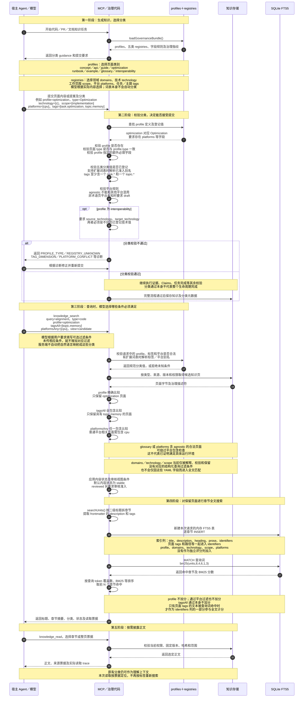

# KunpengKnowledge 分类元数据生命周期时序图

整理日期：2026-11-17。源码仓为 KunpengSDK/KunpengKnowledge，核对时 HEAD 为 `395e1a61287cff31a06200b055171b1b8362ba09`。根据源码静态核对，展示受治理知识的生成、校验、检索和读取；各知识域实际使用的开始、提交及完成接口不同。本图不是一次真实运行的调用记录。

`profiles.yaml` 定义页面类别、对应的页面 `type` 和额外必填字段；`registries.yaml` 定义 domains、technology、scope、platforms、tags 的合法取值。参见同目录的 [知识系统精简说明](knowledge-system-notes.md)。

## 图中概念的边界

- 搜索参数 `type=code/kernel/document` 是知识域；页面 `type=Guide/Optimization/...` 是与 profile 对应的页面类别，二者不同。
- `task.*`、`topic.*` 表示标签维度；图中“至少一个”是提交时的规则，不是通配搜索语法。
- `profile=optimization` 不要求自动配对 `task.optimization`；它们分别描述页面类别和任务。
- 分类通过、原生完成、存储同步、人工审核、项目激活及远端 Git 发布是不同状态。
- 图中的读取和索引都是服务端操作；服务端读取了候选全文，不代表这些全文都进入模型上下文。

## 源码定位

以下为 KunpengKnowledge 源码仓内的相对路径；本目录不包含生成的知识产物或私有状态。

| 环节 | 实现位置 |
|---|---|
| profile 定义 | `src/governance/resources/profiles.yaml` |
| 核心词表 | `src/governance/resources/registries.yaml` |
| 加载指导与提交校验 | `src/governance/contract.js`：`loadGovernanceBundle`、`guidance`、`validatePage` |
| 查询过滤 | `src/governance/query.js`：`validateGovernanceFilters`、`matchesGovernance` |
| 查询侧词表解释 | `src/unified/knowledge/knowledge-query-policy.ts`：`normalizeRequest`、`rows` |
| 章节、FTS5 与排序 | `src/domains/query-rank.cjs`：`searchUnits`、`rankEntries` |
| 查询与读取主链路 | `src/unified/knowledge/query-controller.ts`：`searchImpl`、`readImpl` |
