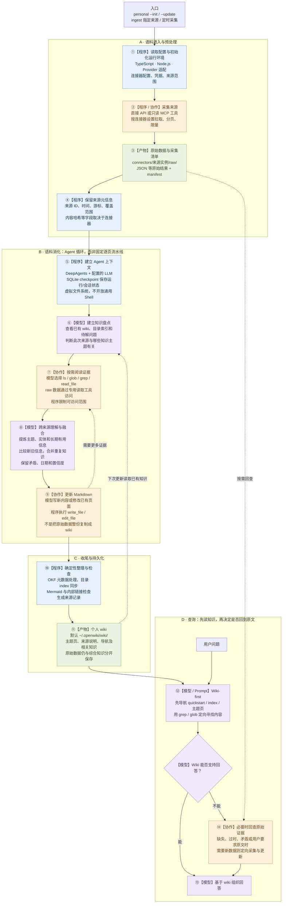
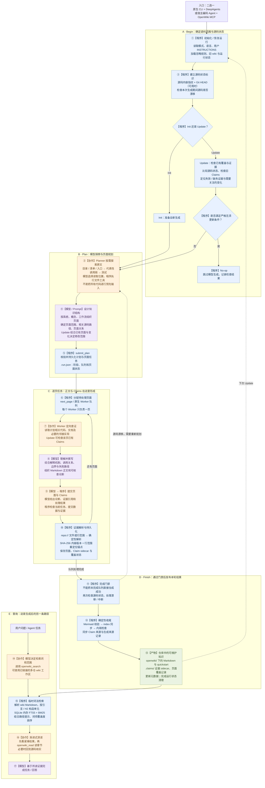

# OpenWiki 个人知识库与代码仓知识库：技术流程与职责边界

整理日期：2026-10-28。

版本范围：基于本次核对的官方 `langchain-ai/openwiki` 仓库 `main` 公开源码，`package.json` 显示 **0.7.2**。部分公开源码页面存在抓取缓存，未锁定实时提交 SHA，因此本文不能保证对应阅读时的最新 HEAD。后续版本变化时，应重新核对文末源码链接。

本文覆盖语料进入、消化生成、更新维护和查询使用。两张图中的数字分别表示各自流程的阅读顺序；虚线表示回查、下一轮更新或重新规划，不代表步骤并行。

## 图例与阅读约定

| 标识 | 颜色 | 执行主体与约束含义 |
| --- | --- | --- |
| 【程序】 | 蓝色 | TypeScript/Node.js 代码执行、状态管理或强制校验；并非外接 Shell 脚本。 |
| 【模型】 | 紫色 | LLM 决定阅读、理解和综合方式；Prompt 是行为指导，不等于程序保证。 |
| 【协作】 | 橙色 | 模型发起工具调用，程序执行操作并控制权限、输入和结果校验。 |
| 【产物】 | 绿色 | 保存下来的知识文件、原始数据、证据或状态。 |

> 核心结论：两种模式都不是“先把全部语料 embedding，再通过向量召回生成 wiki”的管线。个人模式主要依靠模型融合多源知识；代码模式在模型写作外，增加页面任务状态机和源码级证据维护。

## 一、个人知识库

核心路径是：**连接器采集 → 模型融合 → Wiki 优先问答**。它不是代码仓的逐页任务队列。运行由 DeepAgents、配置的 LLM、连接器工具和受限文件系统工具共同完成。

### 个人知识库图注

1. **采集与理解是两步。** 连接器先保存 raw 数据和 manifest，随后由来源特定的 Agent 运行综合知识。采集成功不等于内容已经被充分理解或写进 wiki。
2. **并非所有输入都必须重新抓取。** 图从连接器采集入口展开；已有 raw 数据或已经提供的来源材料，可以进入相关证据阅读和综合阶段。普通问答也不会默认重新采集所有连接器。
3. **模型负责语义融合。** 来源选择、知识主题判断、去重合并、置信度和 Wiki-first 问答，主要通过 Prompt 指导模型完成。“要求模型去重”不是数据库唯一键约束。
4. **程序负责执行边界。** 连接器落盘、raw 读取范围、虚拟文件系统权限和确定性索引处理属于程序机制；个人模式不开放通用 Shell 工具。
5. **原始语料与综合知识分开存储。** 默认 raw 路径是 `~/.openwiki/connectors/<来源实例>/raw/`，wiki 路径是 `~/.openwiki/wiki/`；配置目录可通过 `OPENWIKI_CONFIG_DIR` 改变。
6. **SQLite checkpoint 不等于向量数据库。** 此处用于 Agent 运行/会话状态，不表示已经生成语料 embedding。
7. **更新感知依赖来源能力。** 时间戳、游标、内容哈希和采集覆盖范围因连接器而异；不能由本图推断所有链接都会自动感知原文变化，也不能把有哈希理解为有自动轮询。
8. **个人模式不照搬代码仓的 Claims 队列。** 本图未将 `submit_plan → next_page → submit_page` 或源码证据 sidecar 画成个人知识库的通用机制。
9. **查询首先导航 wiki。** 默认通过 quickstart/index、主题页及定向 grep/glob 寻找知识。仅在知识缺失、过时、矛盾或用户要求原始证据时回查 raw；不能将此图读成强制每次问答都展开原文。

## 二、代码仓知识库

核心路径是：**源码检查 → Plan → 页面 Worker → Claims → 确定性收尾**。模型决定知识内容，TypeScript 生命周期决定当前阶段允许哪些操作。

### 代码仓知识库图注

1. **这是内嵌 TypeScript 编排。** 原生 CLI 使用 DeepAgents 创建 Planner 和页面 Worker；宿主集成由宿主模型阅读和写作，通过 MCP 调用 OpenWiki 生命周期。可选 CI/YAML 只是外层触发方式，不负责核心知识生成逻辑。
2. **Begin 图为逻辑分组，不是函数逐行调用顺序。** 源码状态、Claims 准备、更新预检和恢复检查在实现中有具体调用顺序，不能据图推断每个内部函数的严格先后。
3. **Plan 不是源码切块算法。** 模型按清单/入口、代表性调用链、测试逐步探索，设计主题结构。相关路径是阅读线索，不是 embedding 检索结果；不要求完整穷举所有文件。
4. **Plan 中的页面先作为任务存在。** `submit_plan` 保存的是页面规划和任务状态，不代表正文或该页 Claims 已经写好。Worker 在写页面时形成正文和论断，再通过提交操作交给程序检查与保存。
5. **多 Worker 的粒度是一页。** 原生 CLI 可配置并发，宿主集成使用顺序页面生命周期。`quickstart` 最后写；其他页面没有统一的“前一页写完，后一页才能启动”依赖链。图中的循环是任务队列逻辑，不表示所有原生 Worker 串行运行。
6. **页面提交后即可持久化。** 不需要等全部 Worker 完成后，再由一个模型拼接所有正文。最终收尾主要是结构、索引、链接、来源记录和状态检查。
7. **Claims 不等于自动事实证明。** 模型给出论断与证据关联；程序检查引用能否解析以及证据版本。哈希能发现内容变化，不能单独证明模型解释一定正确。
8. **哈希不是 embedding。** 整文件证据使用全部文件内容的 SHA-256；行范围证据使用所选内容的哈希与重定位锚点。Git HEAD 是提交身份，不等于文件内容哈希，也不能单独覆盖未提交的源码变化。
9. **sidecar 与 Claim 不是同一个概念。** Claim 是论断数据；sidecar 是与 Markdown 分开保存的配套记录载体。代码仓的版本化 Claim sidecar 位于 `openwiki/.claims/`。
10. **中断不等于完成。** `openwiki/.run.json` 保存可恢复阶段和页面队列；恢复时若源码发生漂移，会使旧计划失效并要求重新规划。Finish 不能绕过未完成任务直接发布成功结果。
11. **查询与生成分开。** 图 E 展示提供检索工具时的渐进式路径，不代表每个 Agent 都必定调用 MCP。工具不可用时，受其指令影响的 Agent 也可能直接读取 `quickstart.md` 和相关 Markdown。
12. **检索分节作用于生成后的 wiki。** `marked` 解析 Markdown，主要按引言/H2 构造搜索单元，再用临时 SQLite FTS5/BM25 检索；不是在生成前将全部原始源码向量化。索引按检索调用创建，并在该调用结束时关闭，不是等待整个对话结束才销毁。
13. **FTS5 结果仍需深读。** 紧凑结果用于定位章节，`openwiki_read` 负责展开所选内容；词法匹配不能直接等同于语义向量召回或通用拼写纠错。

## 三、两种模式对照

| 维度 | 个人知识库 | 代码仓知识库 |
| --- | --- | --- |
| 主要输入 | 连接器采集结果、已有 wiki、来源元数据 | 源码、仓内文档、测试、已有 wiki 和证据状态 |
| 消化方式 | 模型跨来源融合并更新持久知识 | Planner 规划主题，页面 Worker 定向阅读和写作 |
| 主体编排 | Agent 工具循环与来源特定运行 | 程序生命周期与持久化页面任务队列 |
| 更新依据 | 重新采集的数据、来源元信息、已有知识 | 源码状态变化、页面覆盖与失效 Claims |
| 证据维护 | 来源说明、引用、时间与置信度等 | 源码文件/行范围、内容版本与 Claim sidecar |
| 图中默认查询路径 | Wiki-first 导航和定向文件搜索 | search → 章节定位 → read → 必要时查源码 |
| 是否统一全量 embedding | 本文核对路径未体现 | 本文核对路径未体现 |

## 四、官方代码与说明依据

以下均指向官方仓库 `main`，链接内容可能随上游更新而变化：

- [版本与依赖：package.json](https://github.com/langchain-ai/openwiki/blob/main/package.json)
- [模式、CLI、连接器、并发与存储说明：README](https://github.com/langchain-ai/openwiki/blob/main/README.md)
- [个人模式 Agent 工厂、工具、权限与 checkpoint：src/agent/index.ts](https://github.com/langchain-ai/openwiki/blob/main/src/agent/index.ts)
- [个人知识融合与 Wiki-first 提示词：src/agent/prompts/personal.ts](https://github.com/langchain-ai/openwiki/blob/main/src/agent/prompts/personal.ts)
- [仓库 Planner、逐页 Worker 与并发：src/agent/repository-runner.ts](https://github.com/langchain-ai/openwiki/blob/main/src/agent/repository-runner.ts)
- [仓库探索、规划与写作提示词：src/agent/repository-prompts.ts](https://github.com/langchain-ai/openwiki/blob/main/src/agent/repository-prompts.ts)
- [仓库生命周期、恢复与持久化状态：src/generation/repository-run.ts](https://github.com/langchain-ai/openwiki/blob/main/src/generation/repository-run.ts)
- [MCP 共享生命周期与会话控制：src/integrations/core/session-manager.ts](https://github.com/langchain-ai/openwiki/blob/main/src/integrations/core/session-manager.ts)
- [OKF、索引、Mermaid、内链与来源收尾：src/agent/wiki-finalizer.ts](https://github.com/langchain-ai/openwiki/blob/main/src/agent/wiki-finalizer.ts)
- [Claims、源码证据与内容版本说明](https://github.com/langchain-ai/openwiki/blob/main/openwiki/concepts/grounded-claims.md)
- [Markdown 分节、临时 FTS5/BM25 与章节读取：src/retrieval/wiki.ts](https://github.com/langchain-ai/openwiki/blob/main/src/retrieval/wiki.ts)

> 渲染说明：本文使用 GitHub 原生支持的 Mermaid 代码块。Markdown 原文保留可编辑图结构，不需要额外上传图片或依赖本地文件。
